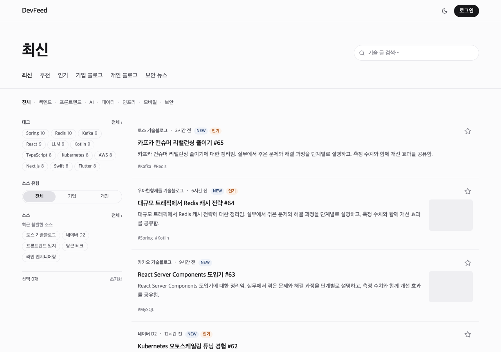
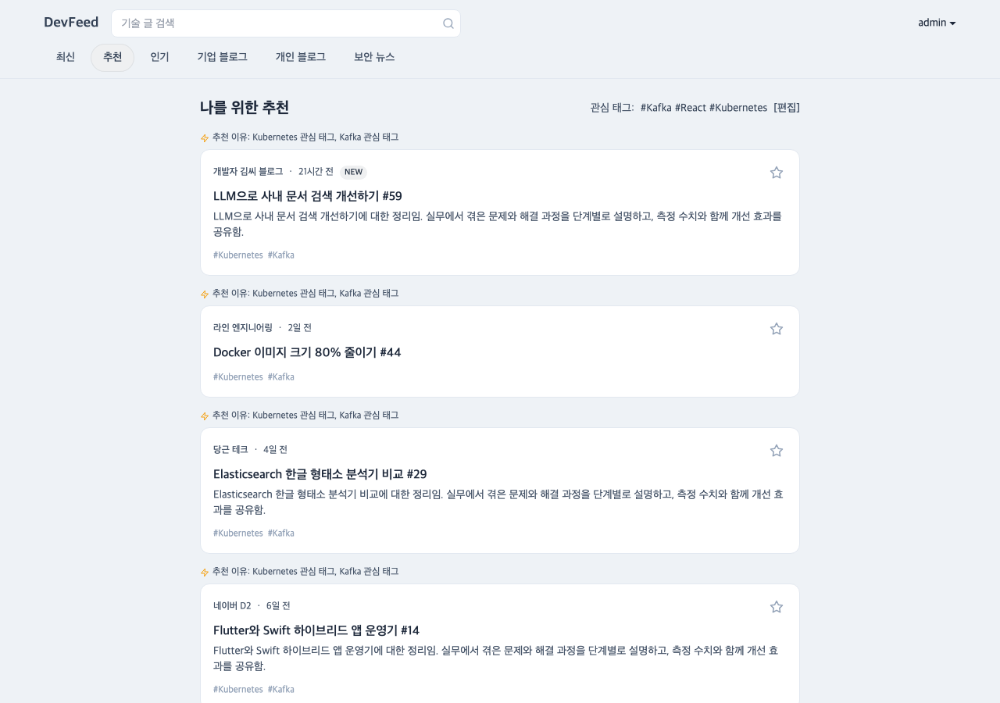
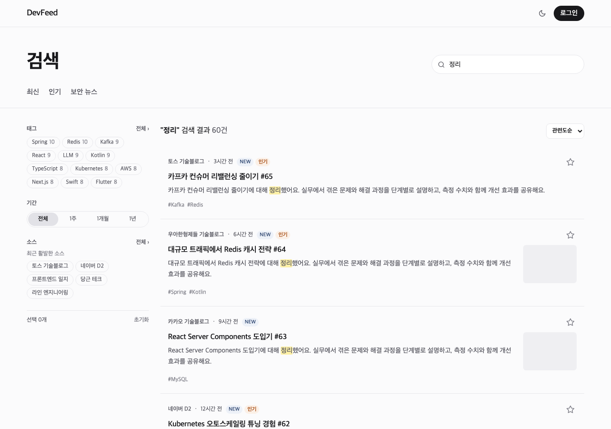
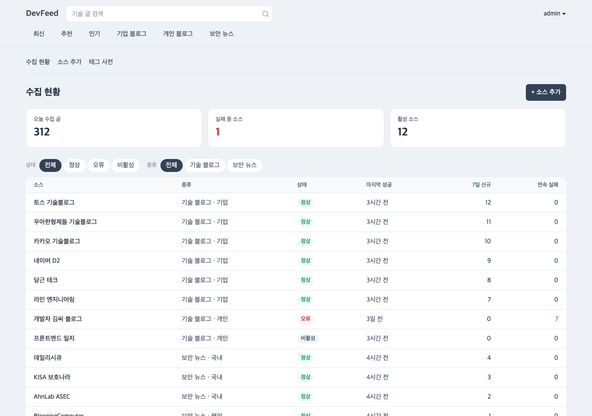

# DevFeed — 기술 블로그 통합 피드 + 한글 검색 + 추천

국내 기술 블로그 36곳의 RSS를 주기적으로 모아, 한곳에서 읽고 한글로 검색하고 관심사에 맞춰 추천받는 개발자용 리더.

- 서비스: https://formulous.org/dev-feed/
- 1인 기획·개발·운영. 기획 → 스키마 → API 명세 → 화면 순서의 계약 우선 개발

## 주요 기능
| 영역 | 내용 |
|---|---|
| 수집 | 소스별 주기 수집, 조건부 요청(ETag), 실패 격리·지수 백오프 재시도, 연속 실패 시 간격 확대·자동 복귀, 중복 0건 |
| 피드 | 커서 기반 무한 스크롤, 태그·소스·유형 필터, 인기 글(24시간/7일/30일) |
| 검색 | 한글 부분 일치 검색, 관련도·최신순, 기간·태그·소스 필터, 검색어 하이라이트 |
| 개인화 | 북마크, 읽은 기록, 관심 태그, 태그 기반 추천 + 추천 이유 표시 |
| 운영 | 관리자 수집 현황·소스 관리·태그 사전·재태깅, 일일 백업, 자동 재시작 |

## 아키텍처
```
브라우저 ── Cloudflare ── nginx (맥미니)
                          ├─ /dev-feed/       → React 빌드 결과 (정적)
                          └─ /dev-feed/api/   → NestJS (launchd 상시 실행)
                                                  ├─ 수집 스케줄러 (DB 선점 잠금)
                                                  └─ MariaDB 12.1 (Docker)
```
- client: React + Vite + onyx-ui, TanStack Query, MSW mock으로 서버보다 먼저 화면 개발
- server: NestJS + TypeORM, JWT 액세스 토큰 + 회전형 리프레시 토큰(HttpOnly 쿠키)
- DB: MariaDB 12.1, 마이그레이션 9개(up/down 검증), 설계 결정 기록 D-01~D-17

## 기술 도전

### 1. ngram 파서 없는 DB에서 한글 부분 검색, 10만 건 p95 923ms → 94ms
- 문제: MariaDB에는 MySQL의 `ngram` 파서가 없어 "리밸런싱"으로 "리밸런싱이"를 찾을 수 없음
- 해결: 저장·질의에 같은 bigram 토큰화 함수를 쓰고 InnoDB FULLTEXT(불리언 모드)로 검색 (D-03)
- 성능: 글 10만 건에서 흔한 단어 검색이 p95 923ms로 목표(300ms) 미달
  1. 원인 분해: 매칭 2.4만 행마다 `posts` PK 조회 + 정확한 COUNT
  2. 건수 상한 1,000 (어차피 50페이지까지만 열람 가능) → 301ms
  3. 비정규화안은 실측 결과 기각 (FULLTEXT 테이블 컬럼 추가가 277초 쓰기 잠금, 이득 미미) → 좁은 커버링 인덱스(56ms 온라인 생성) + 질의 분기 → **94ms**
- 정확성: 13개 기준 질의 정밀도 1.00 유지
- 근거: `docs/discussions/010`, `docs/schema/decisions.md` D-03·D-15

### 2. 장애에 강한 수집 파이프라인
- DB 원자적 선점으로 같은 소스 중복 수집 방지 (서버가 여러 대여도 동작), 큐·Redis 없이 구현 (D-06)
- 정규화 URL·guid 해시 UNIQUE + `ON DUPLICATE KEY`로 동시 수집에도 중복 0건 (D-05)
- 실서버 검증 중 동시 수집 데드락(10곳 중 8곳 실패) 발견 → gap lock 원인 분석, READ COMMITTED·잠금 제거·재시도로 재발 0건
- 근거: `docs/discussions/002`, `005`, `server/README.md`

### 3. 설명 가능한 추천과 측정 가능한 클릭률
- 관심 태그·북마크·읽은 기록(반감기 7일)으로 태그 선호도 → 태그 일치·인기도·최신성 점수, 같은 소스 연속 제한, 추천 이유 표시
- 신규 회원 빈 화면 방지: 콜드 스타트·후보 부족 시 인기순 채움
- 노출·클릭을 알고리즘별로 기록하고 일별 집계를 영구 보관 → 다음 알고리즘(TF-IDF)과 클릭률 비교 가능
- 성능: 회원 1만·읽은 기록 191만 건에서 첫 페이지 p95 18.6ms
- 근거: `docs/discussions/013`, D-10·D-10a

## 화면
| 최신 피드 (S-01) | 추천 (S-02) |
|---|---|
|  |  |
| **검색 (S-04)** | **관리자 수집 현황 (A-01)** |
|  |  |

## 측정 요약 (글 10만 건, 동시 요청 1, API p95)
| API | p95 | 비고 |
|---|---|---|
| 최신 피드 | DB 최악 6.2ms | 커서 깊이와 무관하게 21행만 읽음 (007) |
| 검색 | 94ms | 최초 923ms (010) |
| 추천 | 18.6ms | 동시 요청 10에서 52ms (013) |
- 측정 DB: `devfeed_perf` (글 10만, 회원 1만, 북마크 50만, 읽은 기록 191만), MariaDB 버퍼 풀 128MB(기본값)

## 품질·운영
- 테스트: server 단위 테스트 + e2e(Jest, 전용 DB), client 테스트(Vitest)
- 탈퇴 시 7개 테이블 개인 데이터 잔존 0건을 e2e로 검증 (012)
- 보안: bcrypt, 로그인 잠금, 관리자 권한 분리, IP 기준 요청 속도 제한, Cloudflare 실제 IP 복원, 보안 헤더
- 운영: launchd 자동 재시작, 일일 백업 14일 보관·복원 검증

## 진행 방식
- 역할 4개(기획·DBA·서버·클라이언트)를 Claude Code 세션으로 나눠 계약 우선으로 개발
- 결정은 모두 `docs/discussions/`에 근거와 함께 기록 (001~014)

## 문서
- 기획: `docs/spec/` / 스키마: `docs/schema/` / API: `docs/api/openapi.yaml` / 결정 기록: `docs/discussions/`

---

## 팀 개발 환경

이력서 포트폴리오용 1인 서비스. Claude Code 세션 4개(기획, 클라이언트, 서버, DBA)가 herdr 위에서 역할을 나눠 개발함.

### 구조

```
portfolio/             # 로컬 폴더명 (프로젝트명 dev-feed, 028)
├── CLAUDE.md          # 팀 공통 규칙 (소유권, 소통, 진행 순서)
├── roles/             # 역할 프롬프트 (pm, client, server, dba)
├── docs/
│   ├── spec/          # 기획 (pm)
│   ├── schema/        # ERD·테이블 설계 (dba)
│   ├── api/           # OpenAPI 명세 (server)
│   └── discussions/   # 역할 간 토론 기록 (_template.md)
├── client/            # React + Vite + onyx-ui (client)
├── server/            # NestJS + TypeORM (server)
├── db/                # 마이그레이션·시드 (dba)
├── onyx-ui/           # 공통 UI 서브모듈
└── herdr/start.sh     # 팀 실행 스크립트
```

### 요구 사항

- herdr (`brew install herdr`), jq, Claude Code CLI
- Docker 컨테이너 `mariadb` (MariaDB 12.1, `localhost:3306`)
  - 실행: `docker start mariadb`

### 시작

```bash
git clone --recurse-submodules <repo>    # 또는 git submodule update --init
herdr                                     # herdr TUI 실행
# herdr pane 안에서
./herdr/start.sh --kickoff
```

- `dev-feed` workspace에 2x2 pane이 생기고 agent `pm`, `server`, `client`, `dba`가 실행됨
- 각 세션은 `--append-system-prompt-file roles/<이름>.md`로 역할을 주입받음
- 처음 실행할 때는 각 pane에서 Claude Code 폴더 신뢰 확인 창에 응답해야 함. 응답 후 스크립트가 안내하는 `herdr agent prompt pm ...` 명령으로 kickoff를 보냄
- `--kickoff`를 빼면 agent만 띄우고 작업 지시는 하지 않음

### 협업 방식

- 역할마다 쓰기 가능한 경로가 정해져 있음 (`CLAUDE.md` 참고)
- 의견 교환: `docs/discussions/NNN-주제.md`에 기록한 뒤 `herdr agent prompt <대상> "[from:<나>] ..."`로 알림
- discussion당 왕복은 최대 3회. 결론이 안 나면 pm이 결정하고, 그래도 안 되면 사용자에게 에스컬레이션함
- 진행 순서: 기획 → 스키마 → API 명세 → 화면 (계약 우선)
- 커밋: 각 역할이 작업 단위를 끝내고 검증을 통과하면 자기 경로만 자동으로 커밋함 (`feat(<역할>): ...`). push는 수동으로 함

## 진행 현황

- [x] 팀 골격 구성
- [x] 아이디어 후보 작성 (`docs/spec/00-ideas.md`)
- [x] 서비스 주제 선정: C. 데브피드 (기술 블로그 통합 피드 + 검색·추천)
- [x] 기획서 작성 (`docs/spec/01~04`)
- [x] M0 계약 확정: 스키마 `0001~0007`(dba), OpenAPI v1(server), 검토 완료 (discussion 001~004 decided)
- [x] M1 수집 파이프라인 + 로그인 앞당김 (2026-11-19): 시드 소스 36곳 수집, 중복 0건, 실패 격리·재시도, 관리자 API·로그인 실서버 대조 일치. 브라우저 화면 사용자 확인 완료(formulous.org/portfolio, 009), 006 관리자 온보딩 이동 수정 완료
- [x] M2 피드 (2026-11-19): server API·client S-01·S-03 실서버 연동, 커서 중복·누락 0, dba 10만 건 측정 최악 DB p95 6.2ms, 인기 글 조회수 0 제외(008)
- [x] M3 검색 (2026-11-19): 글 10만 건 c=1 p95 94ms(최초 923ms에서 개선, 010), client S-04 실서버 연동(필터·정렬·하이라이트·1,000건 이상) 확인
- [x] M4 회원·개인화 기본 (2026-11-19): 가입→온보딩→북마크→읽은 기록→탈퇴 실서버 연동, server e2e 9건 통과(탈퇴 잔존 7개 테이블 0건)
- [x] M5 추천 (2026-11-19): 태그 기반 추천·콜드 스타트·다양성·추천 이유, 노출·클릭 기록과 일별 클릭률 집계, e2e 12건, c=1 p95 18.6ms(013), client S-02 실서버 연동
- [x] M6 출시·성능 리포트 (2026-11-19): 공개 https://formulous.org/portfolio/ (noindex 유지), 성능 리포트, 속도 제한·보안 헤더, launchd 자동 실행(서버·nginx·백업), 백업 14일·복원 검증, 개인정보 안내(S-11), 반응형 점검
- [x] M7 탭 확장·보안 뉴스 (2026-11-20, 021): 탭 확대(48px·16px)·6탭(기업·개인·보안 뉴스)·분야 탭 7개(10만 건 p95 최악 9.3ms), 보안 뉴스 국내 3·해외 3곳 수집(첫 수집 165건, 썸네일 0·요약 150자·다른 목록 노출 0)
- [x] 디자인 개편 (2026-11-21, 022): 무채색·글자 탭·구분선 목록, 다크/라이트 테마(시스템 설정 기본·전환 기억), og 이미지 교체. onyx-ui 수정 없음
- [x] 좌우 AdSense 광고 (2026-11-21, 025): 1440px 이상 공개 콘텐츠 5개 화면 좌우 160px. 사이트 승인 대기로 현재 미게재
- [x] M8 좋아요·댓글 (2026-11-21, 026): 6개 화면 반응 줄(♡·💬), 댓글 펼침·답글 1단계·수정·삭제 자리 표시·관리자 숨김, 동시 요청 수 일치, 탈퇴 잔존 0, API p95 최악 137.5ms
- [x] M9 패스키·로그인 개편 (2026-11-22, 027): Linear 느낌 로그인·가입(가운데 스택·탭 숨김·라이트/다크), 패스키 등록·로그인·설정 관리(@simplewebauthn, 챌린지 1회 소비·서명 횟수 역행 거부·회원당 10개), 탈퇴 잔존 0
- [x] 이름·주소 변경 (2026-11-22, 028): 프로젝트명 dev-feed, 공개 주소 https://formulous.org/dev-feed/ (옛 /portfolio/ 404), launchd 라벨 dev-feed. 로컬 폴더명은 유지
- [x] M10 프로필 카드·등급 (2026-11-22, 029): 5개 화면 좌측 프로필 카드(자동 아바타·등급·진행 막대·좋아요/댓글/읽은 글/북마크), 게스트 로그인 카드, 활동 점수 원장(적립·회수·하루 한도·1년 접기), 등급 5단계 Hello World~Architect, 댓글 등급 배지
- [x] M11 기술·보안 탭 개편 (2026-11-22, 031): 1단 탭 기술 뉴스·보안 뉴스 2개 + 내부 탭(기술 최신/추천/인기 `/tech/...`, 보안 최신/인기), 보안 뉴스 인기 신규, 옛 주소 자동 넘김(쿼리 유지), 비회원 추천 클릭 시 로그인 안내
