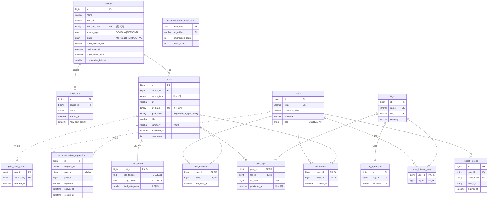

# ERD — 데브피드

- 작성: dba
- 상태: 확정 v1 (M6, 2026-11-19). 마이그레이션 0001~0009 기준, `devfeed` 실제 스키마와 대조 완료
- DB: `devfeed` (MariaDB 12.1, InnoDB, utf8mb4_unicode_ci)
- DDL: `db/migrations/0001~0009`, 컬럼 상세: `tables.md`, 결정 근거: `decisions.md`

## 테이블 요약
| 영역 | 테이블 | 설명 | 기능 |
|---|---|---|---|
| 수집 | `sources` | 수집 대상 블로그. 스케줄링·선점·조건부 요청 상태 포함 | F-001, F-002, F-006 |
| 수집 | `crawl_runs` | 소스별 수집 실행 1회 결과. 90일 보관 | F-002, F-006 |
| 글 | `posts` | 수집한 글 메타데이터. 본문 미저장 | F-003, F-004, F-010~F-013 |
| 글 | `post_search` | 검색용 bigram 토큰 (1:1) | F-020~F-022 |
| 태그 | `tags`, `tag_synonyms` | 태그 사전과 동의어 | F-005, A-04 |
| 태그 | `post_tags` | 글-태그 연결, 노출 순서, 태그 필터용 정렬 키 | F-005, F-011 |
| 회원 | `users`, `refresh_tokens` | 계정·로그인 제한·리프레시 토큰 | F-030, F-032 |
| 개인화 | `user_interest_tags` | 관심 태그 | F-031, F-042 |
| 개인화 | `bookmarks`, `read_histories` | 북마크, 읽은 기록(1년) | F-040, F-041, F-042 |
| 집계 | `post_view_guards` | 조회수 24시간 중복 제외 판단 (24시간 보관) | F-012 |
| 집계 | `recommendation_impressions` | 추천 노출·클릭 기록 (90일) | F-042 |
| 집계 | `recommendation_daily_stats` | 일·알고리즘별 노출·클릭 집계 (영구) | F-042 |
