# ERD — 데브피드

- 작성: dba
- 상태: v1.5 (M12, 2026-11-22). 마이그레이션 0001~0015 기준
- DB: `devfeed` (MariaDB 12.1, InnoDB, utf8mb4_unicode_ci)
- DDL: `db/migrations/0001~0015`, 컬럼 상세: `tables.md`, 결정 근거: `decisions.md`

```mermaid
erDiagram
    sources ||--o{ crawl_runs : "수집 이력"
    sources ||--o{ posts : "수집"
    posts ||--|| post_search : "검색 토큰"
    posts ||--o{ post_tags : ""
    tags ||--o{ post_tags : ""
    tags ||--o{ tag_synonyms : "동의어"
    users ||--o{ refresh_tokens : ""
    users ||--o{ user_interest_tags : "관심 태그"
    tags ||--o{ user_interest_tags : ""
    users ||--o{ bookmarks : ""
    posts ||--o{ bookmarks : ""
    users ||--o{ read_histories : ""
    posts ||--o{ read_histories : ""
    posts ||..o{ post_view_guards : "FK 없음"
    users |o..o{ recommendation_impressions : "FK 없음"
    posts ||..o{ recommendation_impressions : "FK 없음"
    users ||--o{ post_likes : likes
    users ||--o{ user_passkeys : has
    users ||--o{ score_events : earns
    posts ||--o| community_posts : "kind=COMMUNITY 확장"
    users |o--o{ community_posts : writes
    community_posts |o--o| comments : accepted
    report_targets ||--o{ reports : has
    users |o--o{ reports : reports

    community_posts {
        bigint post_id PK, FK
        bigint user_id FK
        enum category "QUESTION|DISCUSSION|SHARE"
        mediumtext body "마크다운"
        enum status "VISIBLE|HIDDEN|DELETED"
        bigint accepted_comment_id FK
        datetime published_at
    }
    report_targets {
        enum target_type PK "POST|COMMENT"
        bigint target_id PK
        int report_count
        enum state "PENDING|HIDDEN|CLEARED"
    }
    reports {
        bigint id PK
        bigint reporter_id FK
        enum reason
    }

    score_events {
        bigint user_id PK, FK
        enum kind PK "READ|LIKE|COMMENT|ARCHIVE"
        bigint ref_id PK
        int points
        datetime created_at
        datetime revoked_at "COMMENT만"
    }
    users |o--o{ webauthn_challenges : "REGISTER만"

    user_passkeys {
        bigint id PK
        bigint user_id FK
        varbinary credential_id UK
        varbinary public_key
        int sign_count
        varchar name "40자"
        datetime last_used_at
    }
    webauthn_challenges {
        binary challenge_hash PK "SHA-256"
        enum purpose "REGISTER|LOGIN"
        bigint user_id FK
        datetime expires_at "5분"
    }
    posts ||--o{ post_likes : liked
    posts ||--o{ comments : has
    users |o--o{ comments : writes
    comments |o--o{ comments : "replies (1단계)"

    post_likes {
        bigint user_id PK, FK
        bigint post_id PK, FK
        datetime created_at
    }
    comments {
        bigint id PK
        bigint post_id FK
        bigint parent_id FK "NULL=댓글"
        bigint user_id FK "DELETED면 NULL"
        varchar body "1000자"
        enum status "VISIBLE|HIDDEN|DELETED"
        int reply_count
        datetime edited_at
        datetime hidden_at
    }

    sources {
        bigint id PK
        varchar name
        varchar feed_url
        binary feed_url_hash UK "생성 컬럼"
        enum source_type "COMPANY|PERSONAL"
        enum kind "BLOG|SECURITY_NEWS"
        enum region "DOMESTIC|OVERSEAS, 뉴스만"
        enum status "ACTIVE|ERROR|INACTIVE"
        smallint crawl_interval_min
        datetime next_crawl_at
        datetime crawl_locked_until
        smallint consecutive_failures
    }
    crawl_runs {
        bigint id PK
        bigint source_id FK
        enum result
        datetime started_at
        smallint new_post_count
    }
    posts {
        bigint id PK
        bigint source_id FK
        enum source_type "비정규화"
        enum kind "비정규화"
        varchar url
        binary url_hash UK "생성 컬럼"
        binary guid_hash "UK(source_id, guid_hash)"
        varchar title
        varchar summary "300자"
        datetime published_at
        int view_count
        int like_count "비정규화"
        int comment_count "비정규화"
    }
    post_search {
        bigint post_id PK, FK
        text title_tokens "FULLTEXT"
        text body_tokens "FULLTEXT"
        varchar feed_categories "재태깅용"
    }
    post_tags {
        bigint post_id PK, FK
        bigint tag_id PK, FK
        tinyint tag_rank "1~5"
        datetime published_at "비정규화"
        enum kind "비정규화"
    }
    tags {
        bigint id PK
        varchar name UK
        varchar slug UK
        varchar category
    }
    tag_synonyms {
        bigint id PK
        bigint tag_id FK
        varchar synonym UK
    }
    users {
        bigint id PK
        varchar email UK
        varchar password_hash
        varchar nickname
        enum role "USER|ADMIN"
    }
    refresh_tokens {
        bigint id PK
        bigint user_id FK
        binary token_hash UK
        binary family_id
        datetime expires_at
    }
    user_interest_tags {
        bigint user_id PK, FK
        bigint tag_id PK, FK
    }
    bookmarks {
        bigint user_id PK, FK
        bigint post_id PK, FK
        datetime created_at
    }
    read_histories {
        bigint user_id PK, FK
        bigint post_id PK, FK
        datetime last_read_at
    }
    post_view_guards {
        bigint post_id PK
        binary viewer_key PK
        datetime counted_at
    }
    recommendation_daily_stats {
        date stat_date PK
        varchar algorithm PK
        int impression_count
        int click_count
    }
    recommendation_impressions {
        bigint id PK
        binary request_id
        bigint user_id "nullable"
        bigint post_id
        varchar algorithm
        datetime shown_at
        datetime clicked_at
    }
```

## 테이블 요약
| 영역 | 테이블 | 설명 | 기능 |
|---|---|---|---|
| 수집 | `sources` | 수집 대상 블로그·보안 뉴스 (`kind`, 뉴스는 `region`). 스케줄링·선점·조건부 요청 상태 포함 | F-001, F-002, F-006, F-070 |
| 수집 | `crawl_runs` | 소스별 수집 실행 1회 결과. 90일 보관 | F-002, F-006 |
| 글 | `posts` | 수집한 글·보안 뉴스 메타데이터. 본문 미저장 | F-003, F-004, F-010~F-016, F-071 |
| 글 | `post_search` | 검색용 bigram 토큰 (1:1) | F-020~F-022 |
| 태그 | `tags`, `tag_synonyms` | 태그 사전과 동의어 | F-005, A-04 |
| 태그 | `post_tags` | 글-태그 연결, 노출 순서, 태그 필터용 정렬 키 | F-005, F-011 |
| 회원 | `users`, `refresh_tokens` | 계정·로그인 제한·리프레시 토큰 | F-030, F-032 |
| 회원 | `score_events` | 활동 점수 원장 (`users.score` 캐시) | F-082, F-083, F-093 |
| 커뮤니티 | `community_posts` | 사용자 글 본문·말머리·상태·채택 (`posts` 1:1 확장) | F-090, F-091 |
| 커뮤니티 | `report_targets`, `reports` | 신고 대상 요약·신고 1건 | F-092 |
| 회원 | `user_passkeys`, `webauthn_challenges` | 패스키 공개키·서명 횟수, 1회용 챌린지(5분) | F-034 |
| 개인화 | `user_interest_tags` | 관심 태그 | F-031, F-042 |
| 개인화 | `bookmarks`, `read_histories` | 북마크, 읽은 기록(1년) | F-040, F-041, F-042 |
| 반응 | `post_likes`, `comments` | 좋아요, 댓글·답글(1단계) | F-080, F-081 |
| 집계 | `post_view_guards` | 조회수 24시간 중복 제외 판단 (24시간 보관) | F-012 |
| 집계 | `recommendation_impressions` | 추천 노출·클릭 기록 (90일) | F-042 |
| 집계 | `recommendation_daily_stats` | 일·알고리즘별 노출·클릭 집계 (영구) | F-042 |
